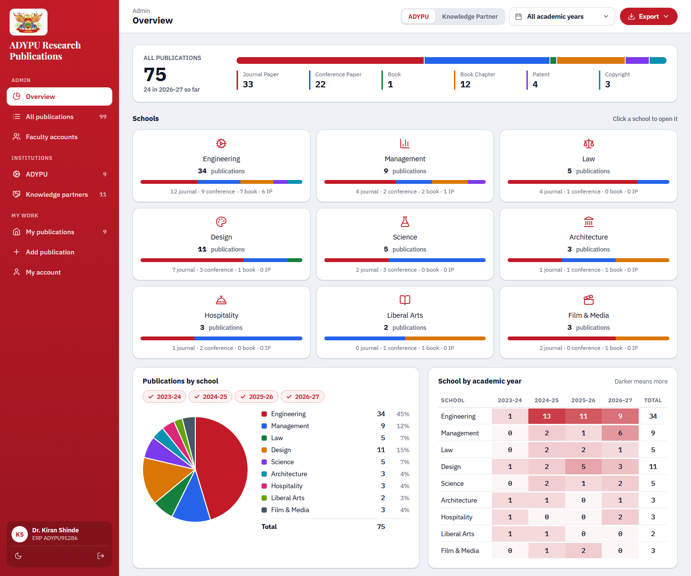
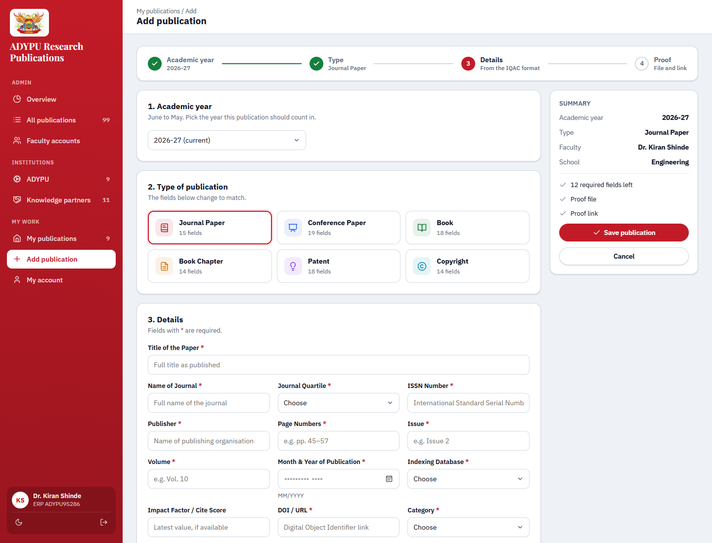
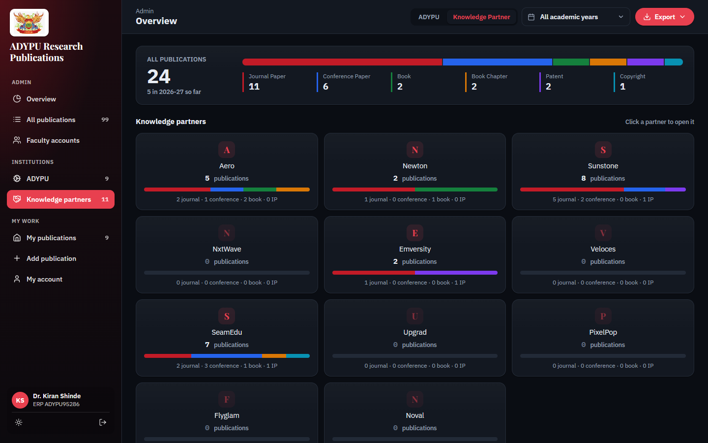

# ADYPU Research Publications

Research output for Ajeenkya D Y Patil University: faculty from nine schools and
eleven knowledge partners log their papers, books, patents and copyrights, and
admins see the totals by school and academic year.



*Names and figures in these screenshots are sample data.*

## What it does

- **Six types, one format.** Journal papers, conference papers, books, book
  chapters, patents and copyrights. Each type asks for exactly the fields in the
  IQAC "Format For Research Data Collection" workbook, so an export reads like
  the format the university already uses.
- **Proof for every entry.** A PDF or image (up to 5 MB), a link, or both. Every
  table flags an entry that is missing either one.
- **Academic years run June to May**, written as 2025-26. Faculty pick the year
  first, so a paper always counts where they meant it to.
- **Totals that drill down.** The overview splits every count by type, then by
  school or partner; open one to see its departments, and click a department to
  filter the list below it.
- **Exports** to Excel (a summary tab plus one tab per type with every field),
  CSV, and a print page for PDF, all following the filters on screen.
- **Light and dark themes**, following the system setting, with a toggle in the
  sidebar.



## The six types

| Type | Fields | Notes |
| --- | --- | --- |
| Journal Paper | 15 | Includes the journal quartile (Q1 to Q4), which the workbook does not have |
| Conference Paper | 19 | |
| Book | 18 | |
| Book Chapter | 14 | |
| Patent | 18 | |
| Copyright | 14 | |

Counts include the proof. Fields the workbook marks "(if available)" or
"(if applicable)" are optional; the rest are required. Every type is defined in
one place, `includes/types.php`, and the form, its checks, the tables and every
export column follow from it.

## Accounts

- **Faculty sign up themselves** with their name, ERP number, school or partner,
  department and designation. ERP is required for ADYPU schools and optional for
  partners, and no two accounts can share one.
- **Join codes.** Each school and partner can have a code. The right code
  activates an account straight away; without one, the account waits for an
  admin to approve it.
- **Admins** approve or disable accounts, edit details, reset a password to a
  temporary one, make other admins, and rotate join codes, all from the Faculty
  accounts page. There is no email on the host, so there are no reset links.
- **Publications need no approval.** Faculty see and edit only their own; admins
  see everything.

Sign-in here is separate from the attendance dashboard's, by decision, and the
two sites keep separate sessions even on the same host.



## Running it

PHP 8.1 or newer with the `fileinfo` extension (proof uploads) and `zip` (Excel
export). No framework, no Composer, no database, no build step.

```
cp includes/config.local.example.php includes/config.local.php
php -r "echo password_hash('your-password', PASSWORD_DEFAULT), PHP_EOL;"
```

Put your email and that hash into `includes/config.local.php`. That is the first
admin; everyone else signs up at `/login.php`.

```
php -S localhost:8000        # then open http://localhost:8000
php tools/seed-demo.php      # made-up faculty and publications to try it with
php tests/run.php            # field definitions, form checks, sign-up, counts
```

Every demo account's password is `demo1234`. Delete `data/` to start clean.

## Deploying

The host is InfinityFree-style shared hosting: FTP only, no SSH, no git deploy.

```
tools/stage-upload.sh           # files changed since the last commit
tools/stage-upload.sh HEAD~3    # files changed over the last 3 commits
tools/stage-upload.sh --all     # everything, for a fresh install
```

It copies exactly the files the server needs into `upload/`, paths intact, so the
whole folder drops onto htdocs in one go. It never includes `data/`, `tools/`,
`tests/` or `includes/config.local.php`. `.htaccess` is a dotfile, so show hidden
files before selecting everything in `upload/`.

On a fresh install, also:

1. Write a new `includes/config.local.php` on the server with a strong admin
   password. Never upload a local one.
2. Make sure PHP can create and write `data/`.
3. Open `/data/` in a browser and check it answers "not found". `.htaccess` keeps
   `data/`, `includes/`, `tests/` and `tools/` out of reach, and the uploaded
   proofs depend on it.

## Layout

```
index.php            sends admins to the overview, faculty to their own list
login.php            sign in and sign up
mine.php             a faculty member's own publications
add.php              add or edit one, in four steps: year, type, details, proof
view.php             one publication, with delete
proof.php            serves a proof file to its owner or an admin
account.php          own details and password
admin.php            overview by school or partner and year (admin)
school.php           one school or partner, by department (admin)
list.php             every publication, filtered (admin)
accounts.php         faculty accounts and join codes (admin)
export.php           Excel, CSV and the PDF print page (admin)
includes/types.php   the six types and their fields
includes/units.php   schools, partners and departments
includes/pubs.php    records, filters, counts, years, checks, proof storage
includes/auth.php    accounts, sessions, join codes
includes/page.php    page shell, sidebar, totals card, tiles, pie, tables
includes/form.php    renders one field
includes/store.php   reads and writes everything under data/
includes/xlsx.php    the Excel writer
tools/seed-demo.php  demo data
tools/stage-upload.sh  stages the files an upload needs
```

`data/` is never in git and never uploaded: it holds the accounts, the
publications and the proof files the live site wrote for itself. Each data file
is JSON behind a `<?php exit; ?>` line, so asking the web server for one returns
a blank page.

The school list and departments follow the attendance dashboard's, so a school
reads the same on both sites. Law, Architecture, Liberal Arts and Film & Media
have no departments listed yet; their faculty pick Other and type one.
